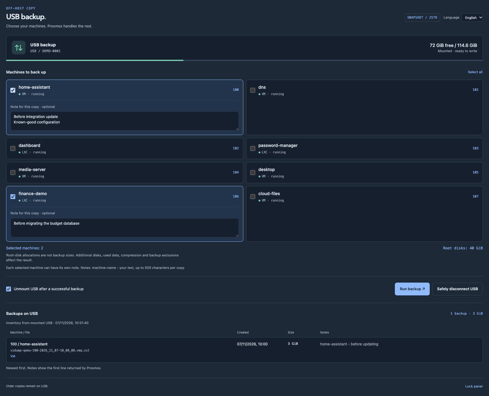
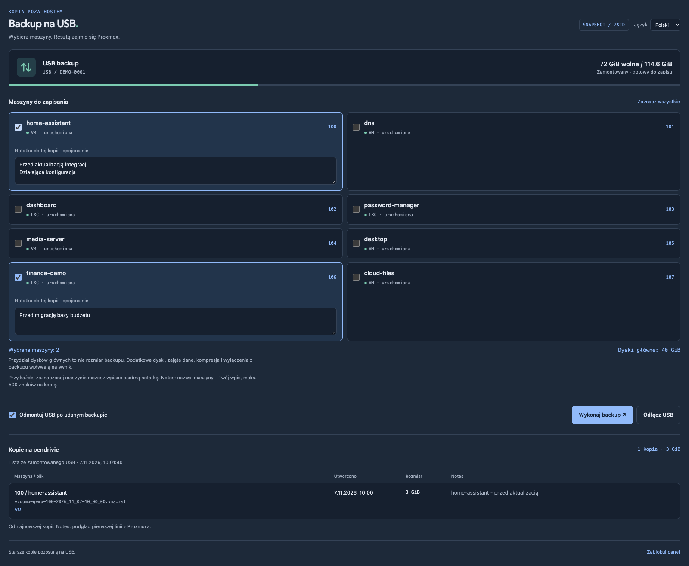

# Glance Proxmox USB Backup

A small, self-hosted USB backup panel for **Proxmox VE**, designed to live inside your **[Glance](https://github.com/glanceapp/glance)** dashboard.

Select VMs and containers, give each backup its own note, run the queue, and safely unmount the USB drive when everything is done. Existing archives remain visible after unplugging the drive through a clearly labelled, timestamped cached inventory.

**Live demo: [English](https://maciejdybowski.github.io/glance-proxmox-usb-backup/?lang=en) · [Polski](https://maciejdybowski.github.io/glance-proxmox-usb-backup/?lang=pl)** · Fictional data, simulated backups, no login or Proxmox connection. All changes stay in browser memory and reset on reload.



[Mobile preview — English](docs/images/panel-mobile-en.png)

<details>
<summary>Polski — desktop and mobile previews</summary>



[Podgląd mobilny — Polski](docs/images/panel-mobile-pl.png)

</details>

## Features

- Automatic discovery of local QEMU VMs and LXC containers.
- Separate **Notes per machine**, saved by native `vzdump` as `{{guestname}} - your note`.
- Sequential snapshot backups with Zstandard compression and **no automatic deletion of older copies**.
- Per-machine progress, task logs, and native Proxmox task history.
- Optional safe unmount **after the entire queue succeeds**.
- Manual **Mount USB** / **Safely disconnect** controls.
- Filesystem UUID checks, `is_mountpoint=1`, and the same `flock` used by `vzdump` before unmounting.
- Archive inventory: VMID, current machine name, timestamp, size, first line of Notes, filename, and protection status.
- Backup jobs survive dashboard closure and panel service restarts.
- HTTPS, a separate panel password, and server-side Proxmox operations. No Proxmox API token in the browser or Glance YAML.
- Responsive layout and automatic iframe height in the full Glance example.
- **English / Polish** UI, locale-aware dates/numbers, and a default language selected during installation.

**Runtime:** Python standard library, native Proxmox tools, systemd. No Docker, pip packages, Node.js service, or database.

The interface supports **English and Polish**, including controls, status messages and application errors. Choose the default at installation, or switch languages in the panel/demo. Machine names, user-authored Notes and native Proxmox logs are not translated. Installation/development documentation is in English. This is an independent community project, not an official Glance or Proxmox component.

## Requirements

- Proxmox VE host with Python **3.11+**, systemd, `vzdump`, `pvesh`, and util-linux tools.
- Root access **on the Proxmox host**, not merely in the Glance container.
- An existing Proxmox **Directory** storage for backups with `is_mountpoint=1`.
- A USB filesystem identified by UUID: **exFAT, ext4, or XFS**.
- A browser that can reach the panel's HTTPS endpoint. Glance itself may run elsewhere.

The original deployment was used on Proxmox VE 9.2 with exFAT. Automated tests mock Proxmox and USB operations; Python-version CI is not a hardware compatibility certification. The installer never partitions or formats a drive.

## Quick start

1. Check your USB UUID and existing storage on the Proxmox host:

   ```bash
   lsblk -o NAME,TRAN,SIZE,FSTYPE,LABEL,UUID,MOUNTPOINTS
   pvesm status
   ```

2. Copy this project to the Proxmox host. From the project directory on your workstation:

   ```bash
   rsync -az --exclude='.git/' --exclude='local/' --exclude='node_modules/' --exclude='dist/' --exclude='test-results/' ./ root@PROXMOX_HOST:/root/glance-backup-upload/
   ```

3. Install on the host, substituting your own values:

   ```bash
   ssh -t root@PROXMOX_HOST 'python3 /root/glance-backup-upload/scripts/install.py --uuid YOUR-FILESYSTEM-UUID --storage usb-backup --filesystem exfat --drive-name "Backup USB" --language en --glance-origin https://glance.example.test'
   ```

4. Open `https://PROXMOX_HOST:8765/`, trust the Proxmox certificate if necessary, and sign in using the separate password you set during installation.

5. Integrate [examples/glance.yml](examples/glance.yml), setting `PROXMOX_BACKUP_URL` in Glance's environment. A minimal fixed-height include is also provided in [examples/glance-widget.yml](examples/glance-widget.yml).

Omit `--language` on a first installation to choose interactively (`en` or `pl`). Upgrades preserve the configured language; original installations without a language setting retain Polish unless explicitly changed.

For repeated deployments, copy `config/deploy.env.example` to **`local/deploy.env`**, edit it, then run:

```bash
bash scripts/deploy.sh
```

The deployment script optionally updates a separate Glance host when you configure it locally. It never uploads `local/deploy.env`.

## Documentation

| Guide | Contents |
| --- | --- |
| [Installation](docs/installation.md) | Storage preparation, install, upgrade, password changes, removal |
| [Configuration](docs/configuration.md) | UUID, filesystems, origins, TLS, Glance integration |
| [Architecture](docs/architecture.md) | Queue, native tasks, USB lifecycle, inventory cache |
| [Development](docs/development.md) | Local tests, browser checks, screenshots, publication export |
| [Contributing](CONTRIBUTING.md) | Small changes, tests, useful bug reports |
| [Security](SECURITY.md) | Trust model and reporting vulnerabilities |

## Repository layout

```text
app/                  Python service, queue worker, browser UI
demo/                 Static, fictional-data simulator for GitHub Pages
scripts/              Installer, deploy helper, password reset, checks, export
deployment/           Installed systemd service template
config/               Non-secret example settings
examples/             Ready-to-adapt Glance YAML
tests/                Mocked backend/API tests and browser scenarios
docs/                 Guides and synthetic screenshots
.github/              CI and issue/PR templates
local/                Your private deployment files — ignored, never exported
```

Installed paths remain `/opt/glance-backup`, `/etc/glance-backup`, and `/var/lib/glance-backup`, so existing installations can be upgraded without changing their password or backup location.

## Development

```bash
make check
```

Browser tests are optional development tooling:

```bash
npm ci
npx playwright install chromium
npm run test:browser
npm run test:demo
```

All test scenarios use temporary files and synthetic API responses. They do not connect to Proxmox, mount devices, or start real backups.

GitHub Pages is built from the same UI plus the in-memory simulator. See [demo deployment](docs/demo.md) for local preview and Pages configuration.

## Publishing a clean copy

```bash
python3 scripts/export-public.py
```

This creates `dist/glance-proxmox-usb-backup.tar.gz` from an explicit public-file allowlist, without `local/`, IDE files, runtime credentials/state, or `.git` history. Use this export when the working repository has previously contained private Homelab configuration. Creating a source archive does not rewrite that repository's existing history.

## License

[MIT](LICENSE).
